# 🏡 Nido — App para residentes de coliving

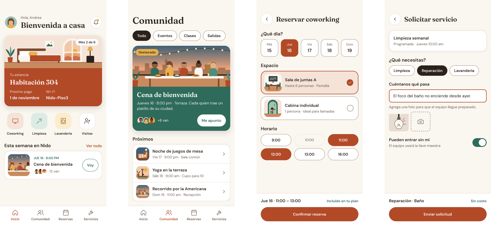

**Nido** es el concepto de una app móvil para residentes de un coliving en Guadalajara. Desde ahí el residente consulta su estancia, se integra a la comunidad, reserva espacios de coworking y pide servicios del edificio.

Es un **proyecto de práctica** para explorar el diseño de interfaces asistido por IA, sin perder la calidad de un sistema de diseño profesional. La marca "Nido" es ficticia y el proyecto no tiene relación con ninguna empresa real.

El repo tiene **dos versiones del mismo concepto**, hechas con herramientas de IA distintas, para comparar los dos flujos:

| | Versión 1 | Versión 2 |
|---|---|---|
| **Herramienta** | Claude Design | Google Stitch + Claude |
| **Enfoque** | Sistema de diseño primero, luego pantallas | Pantallas primero, luego sistema |
| **Pantallas** | 4 | 9 |
| **Figma** | 🔗 [Ver archivo V1](https://www.figma.com/design/UfdaYLcSMFD2oCDriXJQ6h) | 🔗 [Ver archivo V2](https://www.figma.com/design/xelNH6yopJYMGTbcpcwQbG) |
| **Prototipo** | — | ▶️ [Demo en vivo](https://design-screen-companion.lovable.app) · [Código](https://github.com/BryanGEP/nido-app-prototipo) |

> 📍 [Versión 1](#-el-problema) · [Versión 2](#versión-2-google-stitch--claude) · [Prototipo](#prototipo-funcional) · [Comparación](#comparación-de-los-dos-flujos)

---

## 🎯 El problema

En un coliving, el residente necesita resolver cosas operativas (pagos, reservas, limpieza) y sociales (eventos, conocer vecinos). Normalmente eso ocurre en grupos de WhatsApp, correos y formularios separados.

**Nido junta todo en una sola app** con una idea central: que se sienta como *la puerta de una casa compartida*, no como un sistema de reservas.

## 📱 Pantallas

| Inicio | Comunidad | Reservar coworking | Solicitar servicio |
|:---:|:---:|:---:|:---:|
| 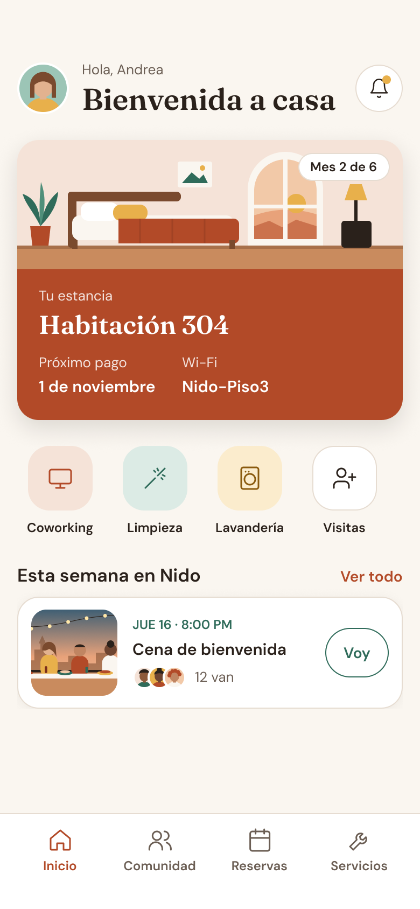 | 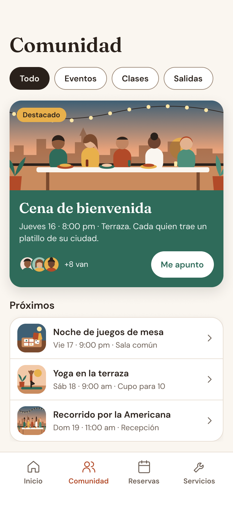 | 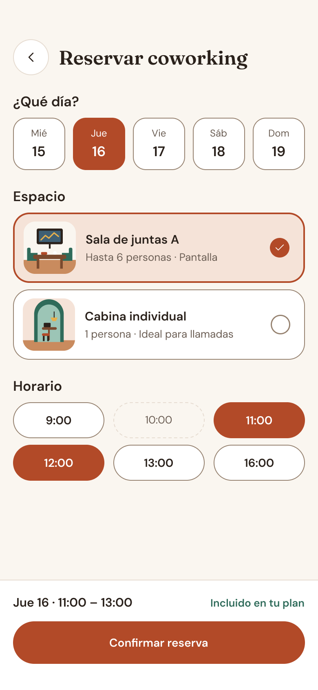 | 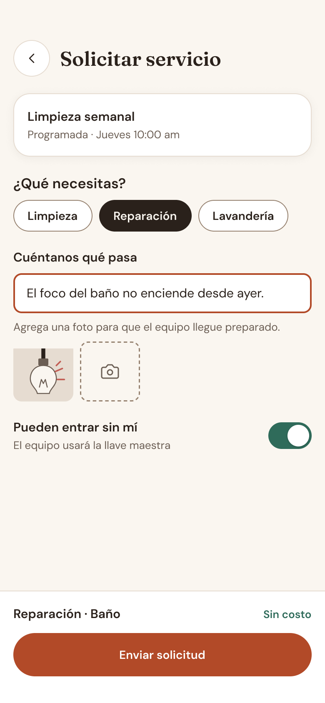 |
| Resumen de la estancia, accesos rápidos y el evento de la semana | Filtros, evento destacado y próximas actividades | Selección de día, espacio y horario, con resumen fijo abajo | Tipo de servicio, descripción, foto adjunta y permiso de acceso |

## 🛠️ Proceso

1. **Sistema de diseño primero.** Antes de dibujar pantallas definí los fundamentos en **Claude Design**: paleta, tipografía, espaciado, radios y sombras, con tema claro y oscuro.
2. **Pantallas a partir del sistema.** Las 4 pantallas usan solo esos tokens, así que el botón principal, los colores y la tipografía son idénticos en todas.
3. **Ilustraciones propias.** 12 ilustraciones planas (habitación, terraza, espacios, avatares) hechas con la paleta de la marca.
4. **Paso a Figma como sistema real.** Con el conector de Figma convertí el diseño en un archivo profesional:
   - **Variables** de color, espaciado, radios y tamaños, con su nombre en código (`var(--terracota-500)`).
   - **Estilos** de texto y de sombra.
   - **21 componentes** (15 con variantes) y propiedades editables (texto, intercambio de ícono e imagen, mostrar/ocultar).
   - **Pantallas armadas con instancias:** si cambias un color o un componente, se actualizan todas.

## 🎨 Sistema de diseño

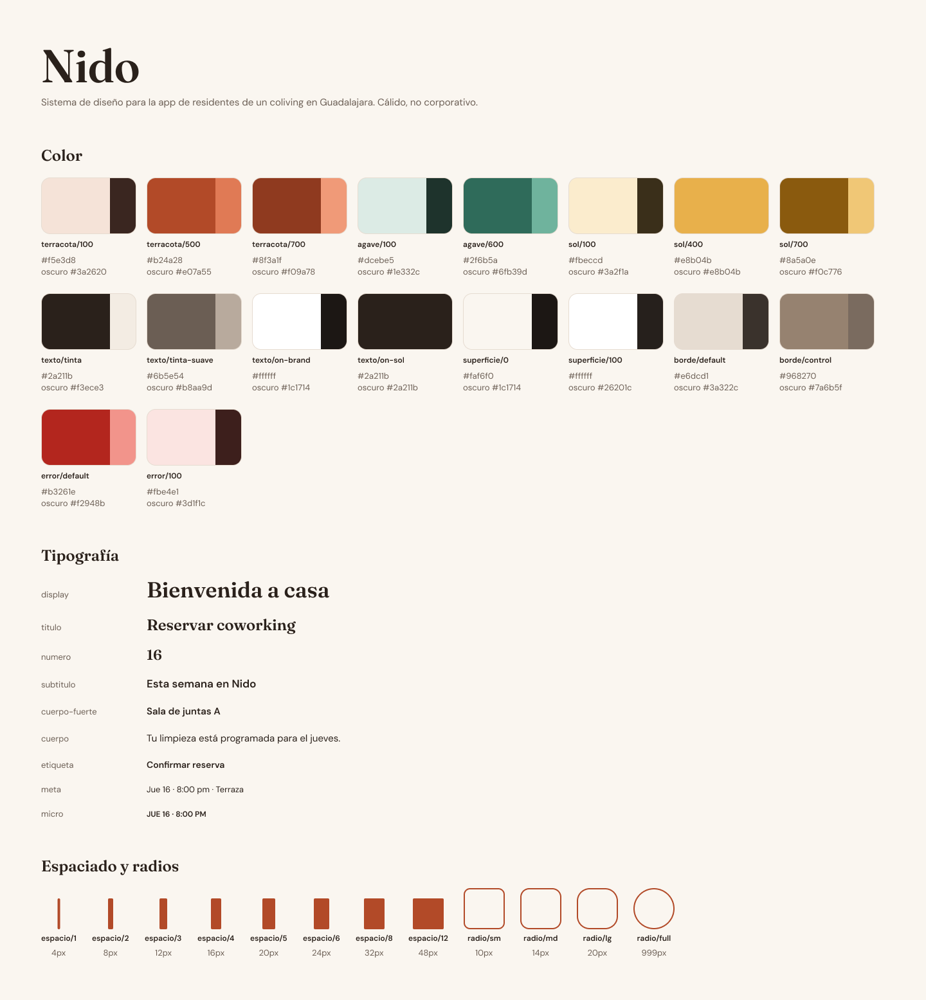

### Principios
- **Cálido, no corporativo:** colores tierra sobre una base crema y títulos en serif.
- **Una acción clara por pantalla:** el botón primario aparece una sola vez por vista.
- **Lo social se distingue de lo operativo:** verde agave para comunidad y terracota para reservas y servicios.
- **Lo importante primero:** la fecha antes que el título y el resumen antes que el botón.

### Color
| Rol | Token | Claro | Oscuro |
|---|---|---|---|
| Marca / acción | `terracota-500` | `#B24A28` | `#E07A55` |
| Comunidad | `agave-600` | `#2F6B5A` | `#6FB39D` |
| Realce | `sol-400` | `#E8B04B` | `#E8B04B` |
| Texto principal | `tinta` | `#2A211B` | `#F3ECE3` |
| Texto secundario | `tinta-suave` | `#6B5E54` | `#B8AA9D` |
| Fondo | `superficie-0` | `#FAF6F0` | `#1C1714` |

### Tipografía
- **Fraunces** (títulos): le da el carácter de hogar.
- **DM Sans** (interfaz): legible a tamaños pequeños.
- Escala: 34 · 24 · 22 · 17 · 15 · 14 · 13 · 12 px.

### Componentes
`Button` · `Chip` · `Badge` · `Avatar` · `Card` · `StayCard` · `EventCard` · `ListItem` · `QuickAction` · `OptionCard` · `DayPicker` · `TimeSlot` · `TextField` · `Switch` · `AppBar` · `TabBar` · `ActionBar`

## ♿ Accesibilidad
- Contraste verificado en **ambos temas**: texto ≥ 4.5:1 y controles ≥ 3:1.
- El color nunca es la única señal: los estados llevan texto o forma (por ejemplo, un horario ocupado va tachado y con borde punteado).
- Zonas táctiles de al menos 44 px.

---

# Versión 2: Google Stitch + Claude

En esta versión cambié el orden: primero generé pantallas con **Google Stitch** y después convertí ese diseño en un **sistema de diseño real dentro de Figma** con Claude.

### Acceso
| Bienvenida | Iniciar sesión | Verificación | Registro |
|:---:|:---:|:---:|:---:|
| 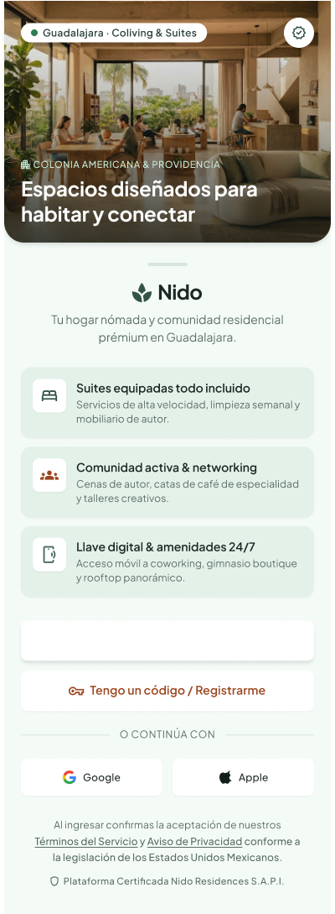 | 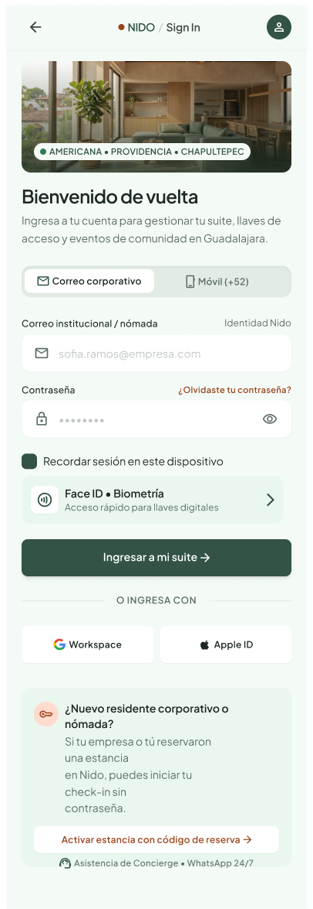 | 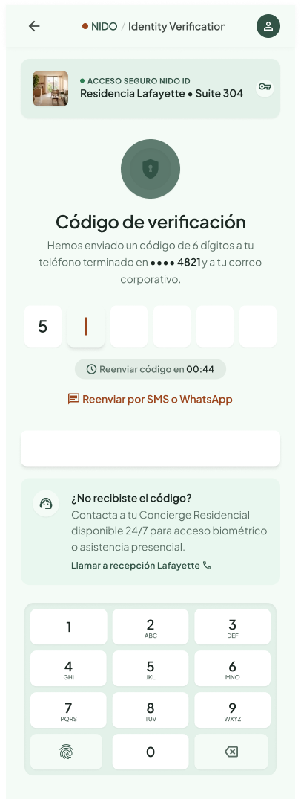 | 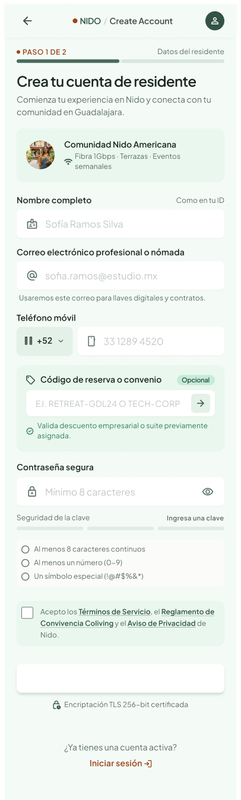 |

### App
| Inicio | Explorar | Detalle | Comunidad | Perfil |
|:---:|:---:|:---:|:---:|:---:|
| 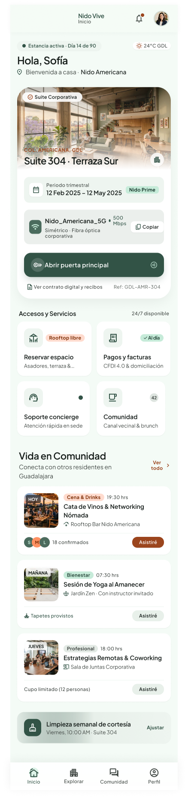 | 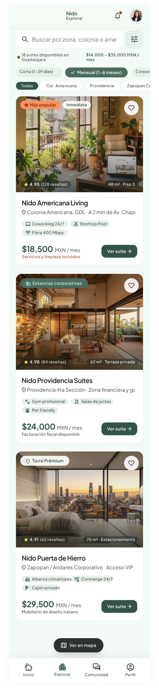 | 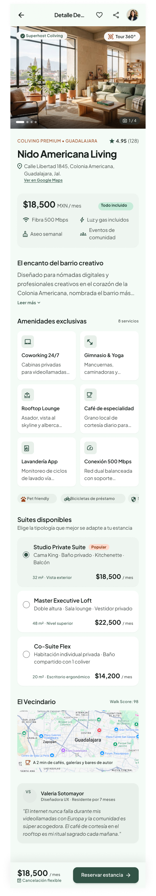 | 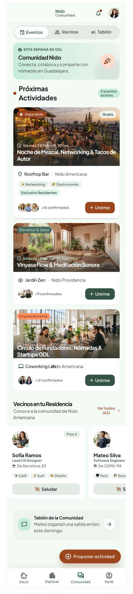 | 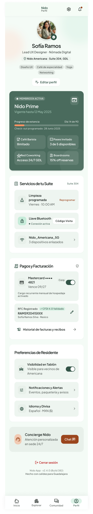 |

### 🛠️ Proceso
1. **Generación en Stitch.** Pantallas a partir de prompts, con fotografías generadas y estilo Material 3.
2. **Importación a Figma.** Exporté desde Stitch e importé con el plugin *html.to.design*. El resultado se ve bien, pero queda **"plano"**: 2,139 capas sueltas, sin componentes, sin variables y sin estilos.
3. **Conversión en sistema con Claude (conector Figma MCP):**
   - **Respaldo** de las pantallas originales antes de modificar nada.
   - **37 variables:** 30 colores con nombres de Material 3 (`primary`, `on-surface`, `surface-container`, `tertiary`…) y 7 radios, conectadas a más de 1,000 rellenos y más de 380 esquinas.
   - **18 estilos de texto** en Plus Jakarta Sans.
   - **147 íconos** convertidos en componentes; cada ícono de las pantallas es una instancia.
   - **16 componentes**, 6 con variantes: botones, chips, píldoras, tarjeta de propiedad, de evento y de vecino, filas, mosaicos, encabezado y barra inferior (una variante por pantalla activa).
   - **Más de 120 piezas** reemplazadas por instancias, conservando fotos y textos.
4. **Verificación:** comparé cada pantalla contra el respaldo. Corregí transparencias perdidas al conectar variables, textos e íconos que no se transfirieron y cuadrículas desacomodadas, hasta que las alturas coincidieron con el original.

### 🚧 Pendiente
- Terminar los componentes de las 4 pantallas de acceso (campos, código de verificación, teclado, casillas).
- Agregar **estados** a los componentes (presionado, desactivado, seleccionado), que Stitch no genera.
- Hoja visual de fundamentos (colores y tipografía) dentro del archivo.

## Prototipo funcional

Para cerrar el flujo llevé las pantallas de V2 a una **app web navegable** con **Lovable**: se puede recorrer desde la bienvenida y el inicio de sesión hasta Inicio, Explorar, Comunidad y Perfil.

**[▶️ Abrir la demo](https://design-screen-companion.lovable.app)** · **[Ver el código](https://github.com/BryanGEP/nido-app-prototipo)** (React + TypeScript + Tailwind, con pruebas de navegación)

**Flujo completo:** Google Stitch (pantallas) → Figma + Claude (sistema de diseño) → Lovable (prototipo).

---

# Comparación de los dos flujos

| | V1 · Claude Design | V2 · Stitch + Claude |
|---|---|---|
| **Velocidad para tener pantallas** | Media | ⚡ Muy alta |
| **Riqueza visual** | Ilustraciones propias | Fotos generadas, look más "producto final" |
| **Consistencia** | ✅ Alta desde el inicio (sistema primero) | Requiere limpiar después |
| **Estructura en Figma** | Componentes y variables desde el principio | Capas planas → hubo que convertirlas |
| **Estados de componentes** | Incluidos | No los genera |
| **Ideal para** | Construir un producto mantenible | Explorar ideas rápido |

**Conclusión:** las dos herramientas se complementan. **Stitch** sirve para explorar direcciones visuales en minutos, y **Claude** para convertir la dirección elegida en un sistema consistente, accesible y listo para un equipo de desarrollo.

## 🧰 Herramientas
- **Claude Design:** sistema de diseño, pantallas e ilustraciones (V1).
- **Google Stitch:** generación de pantallas (V2).
- **Figma:** variables, componentes con propiedades y pantallas finales.
- **html.to.design:** importación del HTML de Stitch a Figma.
- **Conector Figma (MCP):** creación y conversión automatizada del sistema en Figma.
- **Lovable:** prototipo funcional a partir de las pantallas de V2.

## 💡 Aprendizajes
- Definir el sistema **antes** de las pantallas hace que la IA genere rápido **y** consistente.
- Un diseño que "se ve bien" no es lo mismo que un diseño **mantenible**: la estructura (componentes, variables, estilos) es lo que permite escalar.
- Al automatizar cambios en Figma hay que **verificar contra un respaldo**, porque los errores silenciosos (transparencias, textos, cuadrículas) no se ven a simple vista.
- Las propiedades de componente evitan hacer *detach* y mantienen todo vinculado.
- **Variables → marca, componentes → estructura, instancias → contenido.**

---

👤 **Bryan Gael Esquivel Pérez** — Ingeniería en Sistemas Computacionales, TecNM Jiquilpan
[LinkedIn](https://www.linkedin.com/in/bryan-esquivel-perez) · [GitHub](https://github.com/BryanGEP)
